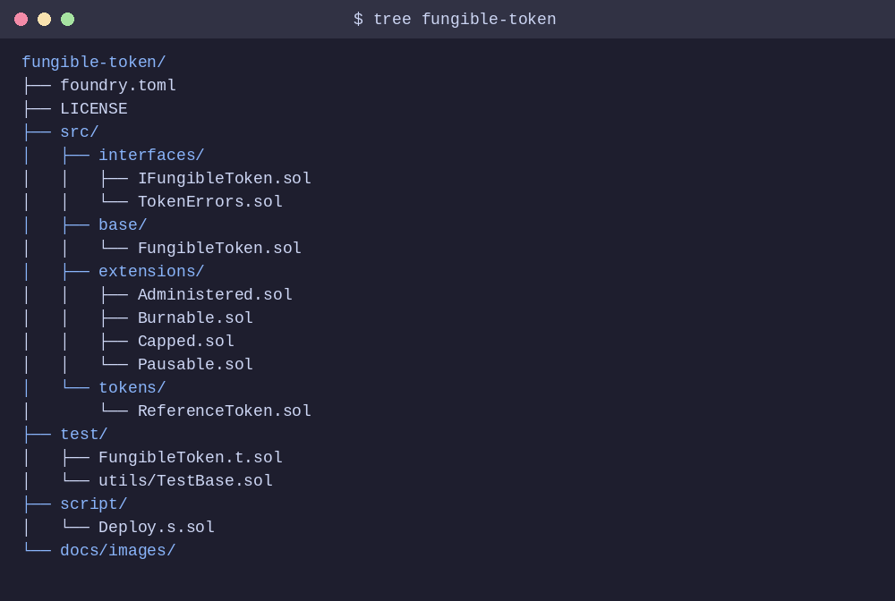
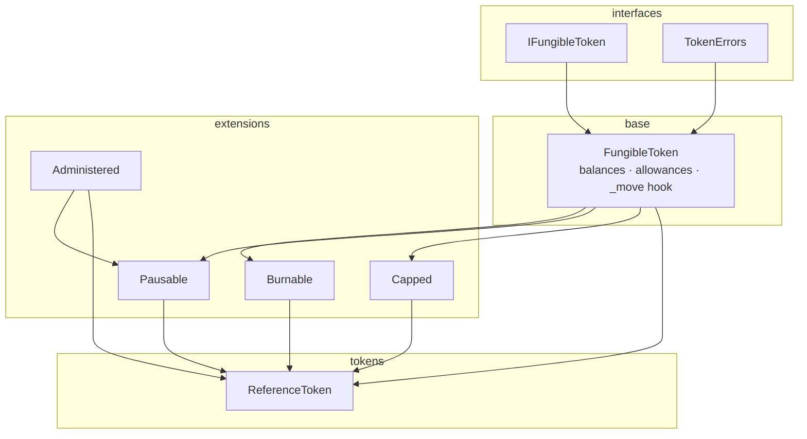
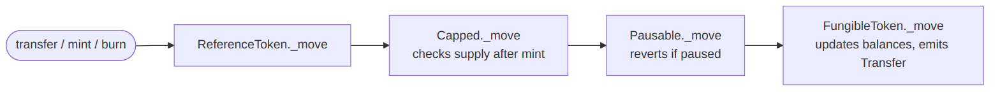
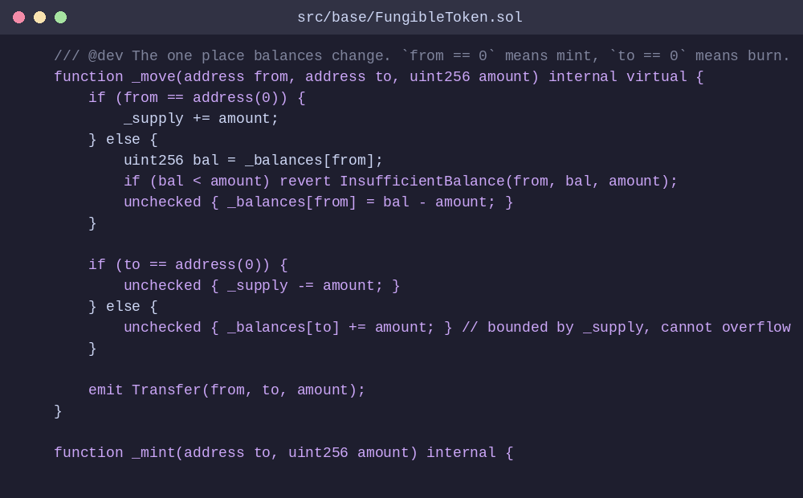
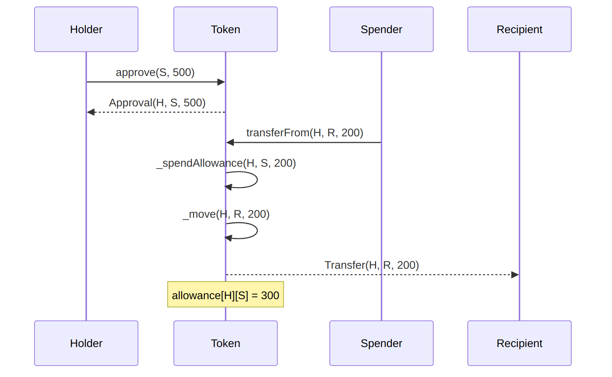
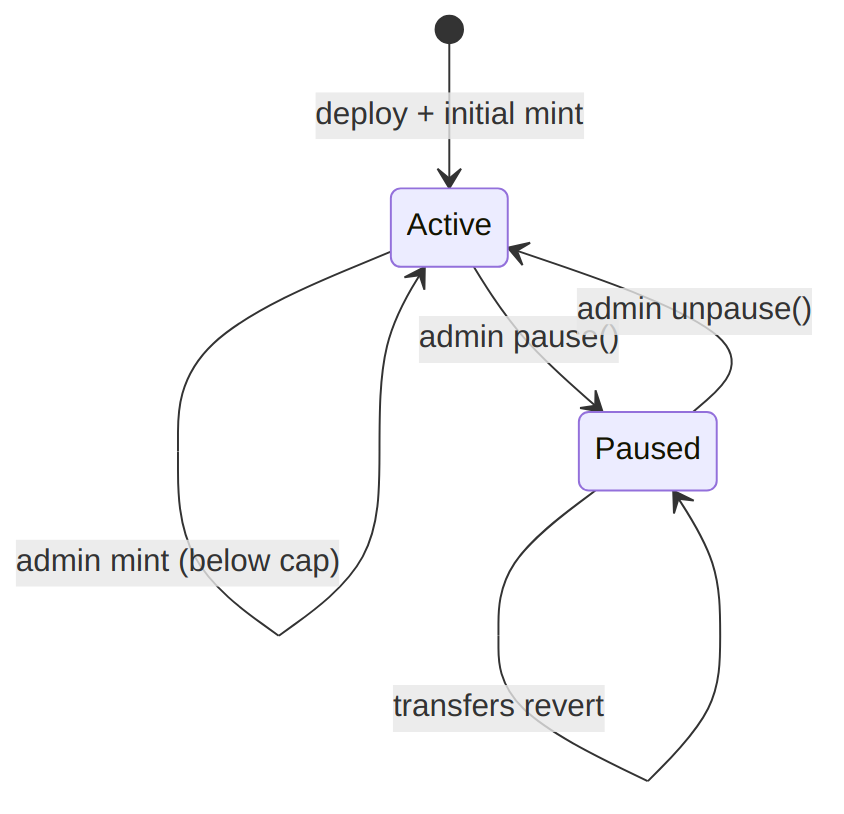

# Modular Fungible Token (ERC-20) in Solidity

A dependency-free ERC-20 implementation split into small, composable Solidity modules,
with Solidity-native tests (Foundry) and a Solidity deploy script

> Educational reference. Review before using with real funds.



## Why this layout

Instead of one monolithic contract, behaviour is added by inheritance. Every module
overrides a single internal hook, `_move`, so features stack without touching the core.

| Module | Adds | Failure mode |
|--------|------|--------------|
| `FungibleToken` | balances, allowances, `transfer`, `approve`, `transferFrom` | `InsufficientBalance`, `InsufficientAllowance`, `ZeroAddress` |
| `Administered` | single admin, two-step handover | `Unauthorized` |
| `Burnable` | `burn`, `burnFrom` | inherits base errors |
| `Pausable` | admin circuit breaker | `TransfersPaused` |
| `Capped` | hard supply ceiling | `CapExceeded` |
| `ReferenceToken` | all of the above, composed | — |

## Architecture



## How a balance change flows

Every mint, burn and transfer passes through the same hook chain:



The core of it:



### Approve and spend



### Token states



## Module reference

### `FungibleToken` (base)

| Function | Notes |
|----------|-------|
| `transfer(to, amount)` | Reverts on zero recipient or low balance |
| `approve(spender, amount)` | `type(uint256).max` is treated as an infinite allowance |
| `transferFrom(from, to, amount)` | Spends allowance, then moves balance |
| `name()`, `symbol()`, `decimals()`, `totalSupply()`, `balanceOf()`, `allowance()` | Standard views |

Custom errors replace revert strings, so callers get typed, decodable failures, e.g.
`InsufficientBalance(account, available, required)`

### Extensions

- **Administered**: `proposeAdmin` / `acceptAdmin` prevents handing control to a wrong address.
- **Burnable**: `burn(amount)` and `burnFrom(holder, amount)` (allowance-based).
- **Pausable**: `pause()` / `unpause()`, admin only; blocks mint, burn and transfer.
- **Capped**: immutable `cap`; minting past it reverts with `CapExceeded`.

### `ReferenceToken`

```solidity
constructor(string name_, string symbol_, uint256 initialSupply, uint256 maxSupply)
```

Supplies are given in whole tokens and scaled by `1e18`. The deployer becomes admin and
receives the initial supply. `mint(to, amount)` is admin-only and cap-bounded.

## Quick start

Requires [Foundry](https://book.getfoundry.sh/getting-started/installation).

```bash
git clone https://github.com/walidwh21/Fungible-Token_ERC20.git
cd "Fungible-Token_ERC20"
forge build
```

## Testing

```bash
forge test -vv
```

Tests are written in Solidity (`test/FungibleToken.t.sol`) and cover transfers, allowances, burning, minting and cap, pausing, admin handover, plus fuzz tests for supply conservation and allowance accounting. They use a tiny local helper (`test/utils/TestBase.sol`), so no external libraries are needed

## Deploying

Edit the constants in `script/Deploy.s.sol` (`TOKEN_NAME`, `TOKEN_SYMBOL`, `INITIAL_SUPPLY`,
`MAX_SUPPLY`), then:

```bash
# local node
anvil
forge script script/Deploy.s.sol --rpc-url http://127.0.0.1:8545 --broadcast --private-key <ANVIL_KEY>

# public network
forge script script/Deploy.s.sol --rpc-url $RPC_URL --broadcast --private-key $PRIVATE_KEY
```

## Design notes & security

- Solidity `^0.8.21`: checked arithmetic by default; `unchecked` is used only where bounded
- Single balance-mutation point (`_move`) keeps invariants easy to reason about
- Known ERC-20 caveat: changing a non-zero allowance directly can be front-run; set it to `0` first
- Admin is a single address; use a multisig for anything beyond experiments

## License

MIT, see [LICENSE](LICENSE).
